<!-- ═══════════════════════  BOOT SEQUENCE  ═══════════════════════ -->

<p align="center">
  <a href="https://fakhiriqbal.vercel.app">
    
  </a>
</p>

<p align="center">
  <a href="https://fakhiriqbal.vercel.app">
    
  </a>
</p>

<p align="center">
  <a href="https://fakhiriqbal.vercel.app"></a>
  <a href="https://www.linkedin.com/in/fakhir-iqbal-a900b4293/"></a>
  <a href="mailto:fakhiriqbal53@gmail.com"></a>
  <a href="https://play.google.com/store/apps/details?id=com.asaannamaz"></a>
</p>

<p align="center">
  
</p>

---

## 🎮 Player Select

<table>
  <tr>
    <td width="34%" align="center" valign="top">
      
      <br />
      <sub><b>🟢 ONLINE</b> — open to freelance &amp; full-time quests</sub>
    </td>
    <td width="66%" valign="top">

```yaml
player:        Fakhir Iqbal
class:         Web & Mobile App Developer
current_guild: TekUnity  # React Native Developer
spawn_point:   Karachi, Pakistan 🇵🇰  (PKT · UTC+5)
playing_since: 2023
main_weapon:   React Native ⚔️
side_weapon:   Next.js 🛡️
special_move:  "Turns Figma into real apps"
passive_skill: Reads error logs before Googling them (mostly)
fuel:          ☕ chai — refills required every 2 hours
status:        Looking for the next boss fight 👾
```

</td>
  </tr>
</table>

> **Lore:** A developer who builds where mobile and web meet — React Native apps for Android,
> SaaS platforms and websites in Next.js, and the APIs and databases behind them.
> Known to take projects from the first screen all the way to the **Play Store** and production.

<p align="center">
  <b>🕹️ Try my live builds →</b>
  <a href="https://schoolovic.vercel.app"></a>
  <a href="https://momentacclaim.com"></a>
  <a href="https://play.google.com/store/apps/details?id=com.asaannamaz"></a>
</p>

---

## 📊 Character Stats

<p align="center">
  
</p>

---

## 🧰 Inventory · Skill Tree

<table>
  <tr>
    <td align="center" width="25%"><b>🖥️ Frontend</b><br /><sub>Unlocked</sub></td>
    <td align="center" width="25%"><b>📱 Mobile</b><br /><sub>Main class</sub></td>
    <td align="center" width="25%"><b>🗄️ Backend &amp; Database</b><br /><sub>Unlocked</sub></td>
    <td align="center" width="25%"><b>🛠️ Tools &amp; Workflow</b><br /><sub>Always equipped</sub></td>
  </tr>
  <tr>
    <td align="center"></td>
    <td align="center"></td>
    <td align="center"></td>
    <td align="center"></td>
  </tr>
  <tr>
    <td><sub>React.js · Next.js · JavaScript · HTML5 &amp; CSS3 · Responsive Web Design</sub></td>
    <td><sub>React Native · React Native CLI · React Navigation · Android · APK / AAB builds · Play Console</sub></td>
    <td><sub>Node.js · Express.js · PostgreSQL · Supabase · Firebase · REST APIs · Auth</sub></td>
    <td><sub>Git &amp; GitHub · Android Studio / SDK · Gradle &amp; ADB · AI-assisted dev · Debugging</sub></td>
  </tr>
</table>

---

## 🧭 Guild History

| ⏳ Season | 🛡️ Guild | 🎭 Role |
|---|---|---|
| Mar 2025 – **Now** | **TekUnity** | React Native Developer |
| Sep 2024 – Feb 2025 | **SCMDOJO** | React Developer |
| May 2024 – Oct 2025 | **SybexLab** | React Native Developer (Hybrid) |
| Nov 2023 – Sep 2024 | **NubitSoftware** | React Native Developer |

---

## 📈 Live Scoreboard

<p align="center">
  
  
</p>

<p align="center">
  
</p>

<h3 align="center">🐍 Boss Level: the snake that eats my commits</h3>

<p align="center">
  <picture>
    <source media="(prefers-color-scheme: dark)" srcset="https://raw.githubusercontent.com/FakhirIqbal/FakhirIqbal/output/github-snake-dark.svg?v=2" />
    <source media="(prefers-color-scheme: light)" srcset="https://raw.githubusercontent.com/FakhirIqbal/FakhirIqbal/output/github-snake.svg?v=2" />
    
  </picture>
</p>

---

## 🛒 Shop · Services for Hire

| Item | What you get |
|---|---|
| 📱 **Mobile App** | React Native apps — screens, navigation, state, API integration |
| 🌐 **Website / Web App** | Responsive sites and web apps with React &amp; Next.js |
| 🏫 **SaaS &amp; Dashboards** | Multi-role platforms and admin panels in Next.js |
| 🔌 **Backend &amp; APIs** | Node.js / Express, PostgreSQL, Supabase, Firebase, auth |
| 🤖 **Play Store Release** | Signed APK/AAB builds, Play Console setup &amp; submission |
| 🛍️ **Shopify &amp; Redesigns** | Storefront work and cleaner, faster UIs |

---

## 🕹️ Continue?

<p align="center">
  <b>Got a project, a role or a boss you can't beat alone?</b><br />
  <sub>Insert coin below — Player 2 is always welcome. 🪙</sub>
  <br /><br />
  <a href="https://fakhiriqbal.vercel.app"></a>
  <a href="mailto:fakhiriqbal53@gmail.com"></a>
  <a href="https://www.linkedin.com/in/fakhir-iqbal-a900b4293/"></a>
</p>

<p align="center">
  
</p>
